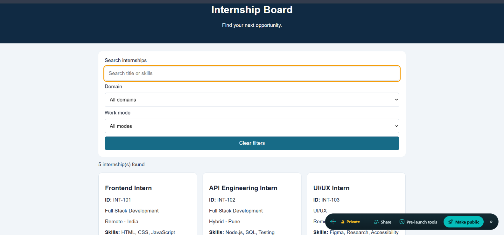
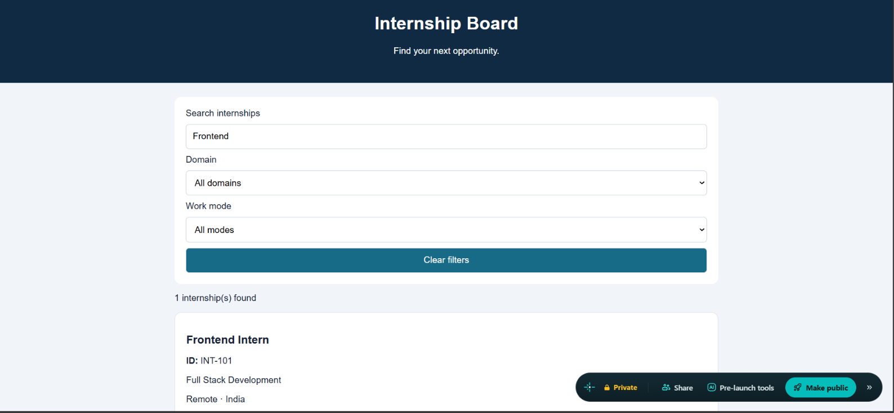

# Responsive Internship Board

A responsive internship listing website built using HTML, CSS, and JavaScript.

## Live Demo
https://responsive-internship-sriram.netlify.app/

## Features
- Displays five internship listings.
- Search internships by title, domain, location, and skills.
- Filter internships by domain and work mode.
- Shows the number of matching internships.
- Displays a message when no internships match.
- Responsive layout for desktop and mobile screens.
- Keyboard-friendly form controls and visible focus indicators.

## Technologies Used
- HTML5
- CSS3
- JavaScript

## Run Locally
1. Clone or download this repository.
2. Open `index.html` in a browser, or use the VS Code Live Server extension.

## Project Structure
- `index.html` — website structure
- `style.css` — layout and responsive styling
- `script.js` — internship data, search, filters, and rendering

## Screenshots

### Internship Board

### Search Filter

## Author
Sri Ram
